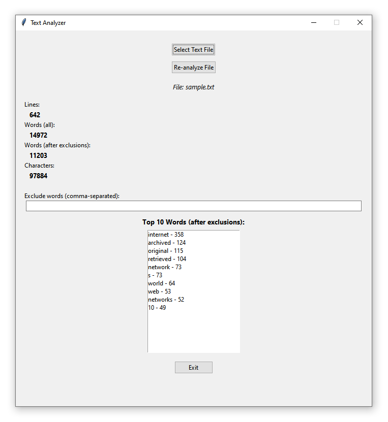

# 📝 Text Analyzer (Python + Tkinter)


## About the Project

Text Analyzer is a desktop application built with **Python** and **Tkinter** for analyzing text files.

The application reads a text file and displays basic statistics, including line count, total word count, filtered word count, and character count. It also identifies the most frequently used words while allowing users to exclude common or custom words from the analysis.

## Screenshots

### Main Window



## Features

- Select and analyze `.txt` files.
- Count lines in a text file.
- Display the total word count before exclusions.
- Display the filtered word count after exclusions.
- Count characters in a text file.
- Display the top 10 most common words after exclusions.
- Automatically exclude common English stop words.
- Add custom words to the exclusion list.
- Double-click a word to add it to the exclusion list.
- Re-analyze the file after changing excluded words.
- Read UTF-8 and UTF-16 text files with supported byte order marks.
- Simple offline desktop interface.

## Technologies Used

- Python 3.7
- Tkinter
- Regular Expressions (`re`)
- Collections (`Counter`)
- pathlib

## Requirements

- Python **3.7**

No external packages are required. The application uses only Python's standard library.

## Project Structure

```text
text-analyzer-python/
├── text_analyzer.py
├── data/
│   └── sample.txt
├── screenshots/
│   └── main-window.png
├── requirements.txt
└── README.md
```

## Installation

1. Clone this repository.
2. Run the application:

```bash
python text_analyzer.py
```

3. Click **Select Text File**.
4. Choose a `.txt` file.
5. Review the text statistics and most common words.

## Sample Data

A `sample.txt` file is included in the `data/` folder for testing the application.

The sample text can be replaced with another `.txt` file to test the analyzer with different types of content.

## How It Works

The application reads the selected text file and:

1. Attempts to decode the file using UTF-8, then UTF-16.
2. Counts the lines and characters in the original text.
3. Extracts all words from the text.
4. Calculates the total word count before exclusions.
5. Removes default English stop words.
6. Removes any custom excluded words entered by the user.
7. Calculates the filtered word count.
8. Identifies the 10 most frequently used remaining words.
9. Displays the results in the application.

### Understanding the Word Counts

The application displays two word counts:

- **Words (all):** The total number of words detected in the original text, before exclusions.
- **Words (after exclusions):** The number of words remaining after default stop words and user-defined excluded words are removed.

The top 10 most common words are calculated using the filtered words.

### Text Encoding

The application attempts to read text files using:

- **UTF-8:** Including files with a UTF-8 byte order mark.
- **UTF-16:** Files containing a UTF-16 byte order mark.

If neither encoding works, the application displays an error and asks the user to save the file using UTF-8 encoding.

The application does not attempt to guess legacy encodings such as Latin-1, because doing so can produce readable-looking but incorrect text.

## Future Improvements

- Add sentence counting.
- Add average word length.
- Add reading-time estimation.
- Add a word-frequency chart.
- Add support for additional file formats.
- Add text search and highlighting.
- Add an option to export analysis results.
- Add support for more text encodings.

